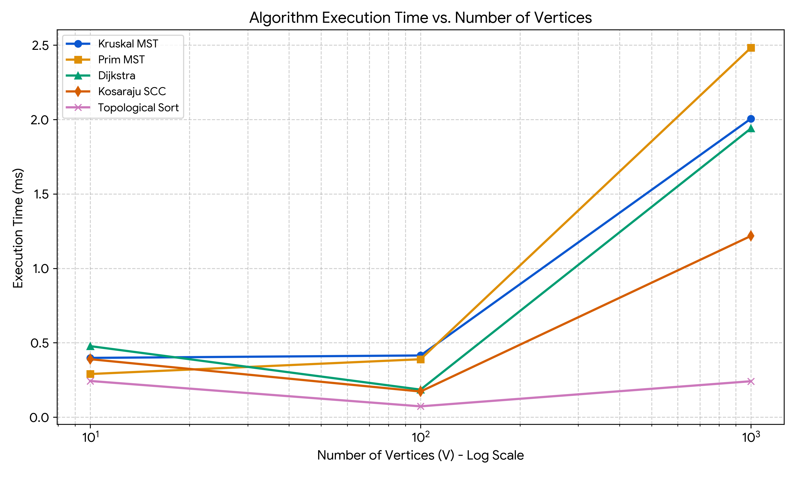
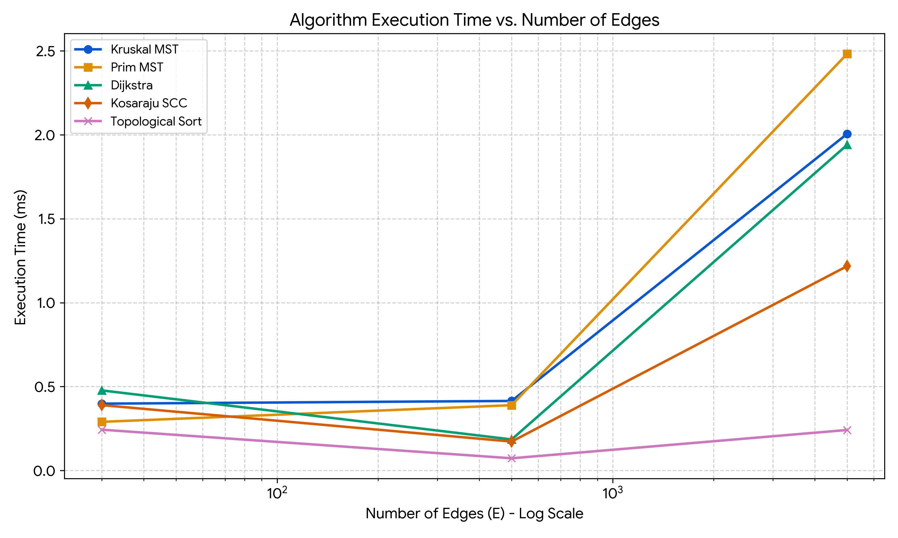
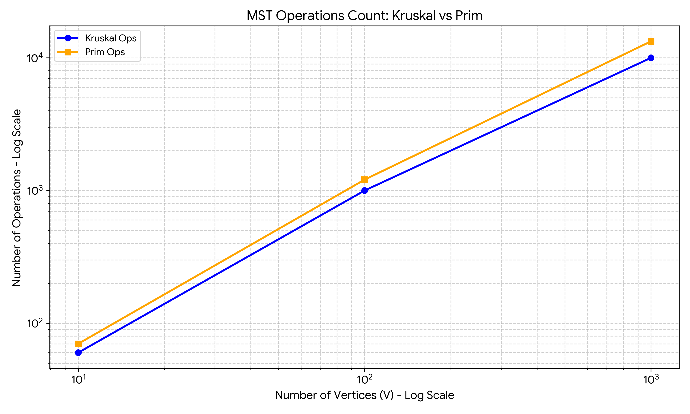

# Assignment 3: Smart City Infrastructure and Route Planning

## Overview
This repository contains a Java application designed to model and analyze a smart city's infrastructure network. The system provides tools for urban planners to connect city districts efficiently, analyze network connectivity, and determine optimal routes. By representing the city as a graph—where vertices are districts and edges are roads or connections—the application allows for the evaluation of construction costs, travel distances, and dependencies.

The project implements several fundamental graph algorithms, compares their theoretical complexity with experimental performance, and provides practical insights into their real-world applications.

## Implementation Architecture
The project is structured into modular Java packages to separate concerns and improve maintainability:

*   **`graph`**: Contains the core graph representation (`Graph`, `Edge`) using an Adjacency List for efficient traversal. It also includes `GraphGenerator` for creating reproducible graphs (connected undirected, directed, and Directed Acyclic Graphs) using fixed random seeds.
*   **`dsu`**: Implements the Disjoint Set Union (DSU) data structure with two crucial optimizations: **path compression** and **union by rank**. This ensures near constant time `O(α(V))` for operations, essential for Kruskal's algorithm.
*   **`mst`**: Contains algorithms to find the Minimum Spanning Tree (MST).
    *   `KruskalMST`: Uses DSU to iteratively add the cheapest edges without forming cycles.
    *   `PrimMST`: Uses a `PriorityQueue` (Min-Heap) to grow the MST from a starting vertex.
*   **`connectivity`**: Analyzes directed graphs.
    *   `KosarajuSCC`: Identifies Strongly Connected Components using two Depth-First Search (DFS) passes (on the original and transposed graphs).
    *   `TopologicalSort`: Determines a valid ordering of dependencies in a DAG using DFS, and detects cycles if ordering is impossible.
*   **`shortestpath`**:
    *   `Dijkstra`: Finds the shortest paths from a source to all reachable districts using a Min-Heap. Includes handling for unreachable vertices and validation against negative edge weights.

## Complexity Analysis

### 1. Disjoint Set Union (DSU)
*   **Time Complexity:** `O(α(V))` amortized per operation (where `α` is the inverse Ackermann function). This is achieved through path compression (flattening the tree structure during `find`) and union by rank (attaching the smaller tree to the root of the larger tree). Practically, this is `O(1)`.
*   **Space Complexity:** `O(V)` to store the `parent` and `rank` arrays.

### 2. Minimum Spanning Tree Algorithms
*   **Kruskal's Algorithm:**
    *   **Time Complexity:** `O(E log E)` or `O(E log V)` to sort the edges. The subsequent DSU operations take `O(E α(V))`. The sorting step dominates the runtime.
    *   **Space Complexity:** `O(E)` to store the sorted edges and `O(V)` for the DSU.
*   **Prim's Algorithm (with Min-Heap):**
    *   **Time Complexity:** `O((V + E) log V)`. In the worst case, every edge is added to the priority queue (`O(E log V)`), and `V` vertices are extracted (`O(V log V)`).
    *   **Space Complexity:** `O(V + E)` for the graph representation and `O(E)` for the priority queue.

### 3. Connectivity Algorithms
*   **Kosaraju's SCC Algorithm:**
    *   **Time Complexity:** `O(V + E)`. It requires two DFS passes over the graph. Creating the transposed graph also takes `O(V + E)`.
    *   **Space Complexity:** `O(V + E)` to store the transposed graph, plus `O(V)` for the recursion stack, `visited` array, and the explicit `Stack`.
*   **Topological Sorting (DFS-based):**
    *   **Time Complexity:** `O(V + E)`. Each vertex and edge is visited exactly once during the DFS traversal.
    *   **Space Complexity:** `O(V)` for the `state` array (unvisited, visiting, visited) and the recursion stack.

### 4. Shortest Path (Dijkstra)
*   **Time Complexity:** `O((V + E) log V)` using a Binary Heap (`PriorityQueue`). Each vertex extraction takes `O(log V)` and each edge relaxation takes `O(log V)`.
*   **Space Complexity:** `O(V)` for the `distances` array, `parents` array, and the Priority Queue.

## Experimental Setup
To benchmark the algorithms, experiments were conducted on three predefined graph sizes:
1.  **Small:** 10 vertices, 30 edges
2.  **Medium:** 100 vertices, 500 edges
3.  **Large:** 1,000 vertices, 5,000 edges

**Generation Methodology:**
*   Graphs were generated using `GraphGenerator` with a fixed seed (`42L` + run index) to ensure strict reproducibility.
*   For MST, the generator first builds a random spanning tree to guarantee connectivity before adding remaining random edges.
*   For SCC and Dijkstra, standard directed graphs were generated.
*   For Topological Sort, Directed Acyclic Graphs (DAGs) were generated by only allowing edges from lower-indexed vertices to higher-indexed ones.

**Measurement:**
*   Each algorithm was run **5 times** per graph size.
*   Execution time was measured using `System.nanoTime()`.
*   Core operations (edge examinations, heap insertions/extractions, DSU unions) were counted.
*   The results below represent the averages of these 5 runs.

## Results

### 1. Minimum Spanning Tree (Kruskal vs Prim)
| Size | Vertices (V) | Edges (E) | Kruskal Time (ns) | Kruskal Ops | Prim Time (ns) | Prim Ops |
|---|---|---|---|---|---|---|
| Small | 10 | 30 | 398,260 | 60 | 289,900 | 70 |
| Medium | 100 | 500 | 414,580 | 1,000 | 389,180 | 1,208 |
| Large | 1,000 | 5,000 | 2,006,420 | 10,000 | 2,483,480 | 13,318 |

### 2. Shortest Paths (Dijkstra)
| Size | Vertices (V) | Edges (E) | Execution Time (ns) | Operations Count |
|---|---|---|---|---|
| Small | 10 | 30 | 477,440 | 47 |
| Medium | 100 | 500 | 185,080 | 780 |
| Large | 1,000 | 5,000 | 1,940,860 | 7,839 |

### 3. Connectivity (Kosaraju SCC & Topological Sort)
| Size | Vertices (V) | Edges (E) | SCC Time (ns) | TopoSort (DAG) Time (ns) |
|---|---|---|---|---|
| Small | 10 | 30 | 389,680 | 243,260 |
| Medium | 100 | 500 | 172,320 | 72,780 |
| Large | 1,000 | 5,000 | 1,218,080 | 241,440 |

### Plots
*(Ensure the generated plots from `results/plots/` are uploaded to your repository and the paths below are correct)*

## Comparison and Discussion

### The JVM Warm-up Anomaly
When analyzing the execution times for Dijkstra, SCC, and Topological Sort, an apparent anomaly exists: the **Small** graphs (10 vertices) frequently take longer to execute (e.g., ~477k ns for Dijkstra) than the **Medium** graphs (~185k ns). This is not an algorithmic inconsistency but a well-documented behavior of the Java Virtual Machine (JVM). During the initial executions (the Small graphs), the JVM incurs the overhead of class loading, memory allocation, and Just-In-Time (JIT) compilation. By the time the Medium and Large graphs are processed, the code has been optimized into native machine code, revealing the true algorithmic scaling.

### MST Performance: Kruskal vs. Prim
Both algorithms exhibit similar performance on Small and Medium graphs. However, on the Large graph (1,000 vertices, 5,000 edges), Kruskal's algorithm (2.00 ms) slightly outperformed Prim's algorithm (2.48 ms).
*   **Prim's Algorithm** is heavily dependent on PriorityQueue operations. For a dense graph, many examined edges result in `O(log V)` heap updates. The operations count shows Prim performed 13,318 operations on the Large graph.
*   **Kruskal's Algorithm** requires an upfront `O(E log E)` sort, but subsequent DSU operations are extremely fast (`O(1)` amortized). Kruskal processed exactly 10,000 operations (edge evaluations and unions). In this sparse-to-medium density scenario, the overhead of heap management in Prim makes Kruskal slightly more efficient.

### Shortest Path and Connectivity
*   **Dijkstra's Algorithm** scales predictably, driven by the `O((V + E) log V)` complexity of the Priority Queue.
*   **Kosaraju SCC** operates strictly in linear time `O(V + E)` via two DFS passes. On the Large graph, it completed in 1.21 ms, significantly faster than Dijkstra's 1.94 ms. This confirms that pure graph traversal without heap management has a lower constant factor.
*   **Topological Sort** was the fastest algorithm overall on Large graphs (0.24 ms). Operating on a DAG, it visits each vertex and edge exactly once `O(V + E)` without maintaining complex secondary structures (like transposed graphs in Kosaraju), resulting in minimal computational overhead.

## Testing and Correctness
The implementation was rigorously verified using JUnit 5. The test suite (`assignment-3-tests.zip`) covers various edge cases and standard scenarios:
*   **MST (`MSTTest`)**: Verifies that Kruskal and Prim return identical weights for connected graphs. Correctly identifies disconnected graphs and handles graphs with multiple valid MSTs and single vertices.
*   **Connectivity (`ConnectivityTest`)**: Ensures Topological Sort produces valid orderings for DAGs and throws an `IllegalStateException` when cycles are detected. Validates that Kosaraju's algorithm assigns every vertex to exactly one Strongly Connected Component.
*   **Shortest Path (`DijkstraTest`)**: Confirms accurate path calculations for non-negative weights, correctly handles unreachable vertices (returning `Integer.MAX_VALUE` and empty paths), and throws an `IllegalArgumentException` if negative weights are encountered.
*   **DSU (`DSUTest`)**: Validates union, find (with path compression), and component counting logic.

## Conclusion
This assignment successfully implements and evaluates a suite of graph algorithms crucial for smart city infrastructure planning.
*   For **infrastructure cost minimization**, Kruskal's algorithm proved slightly more efficient for this network density due to optimized DSU operations.
*   For **dependency resolution** (e.g., utility hookups), Topological Sort provides a highly efficient `O(V + E)` solution.
*   For **route planning**, Dijkstra's algorithm reliably finds optimal paths, though its reliance on priority queues makes it heavier than simple traversal algorithms.
    The experimental results closely align with theoretical complexities, provided JVM warm-up factors are considered.

## Batyrkhan Uvayev SE-2503